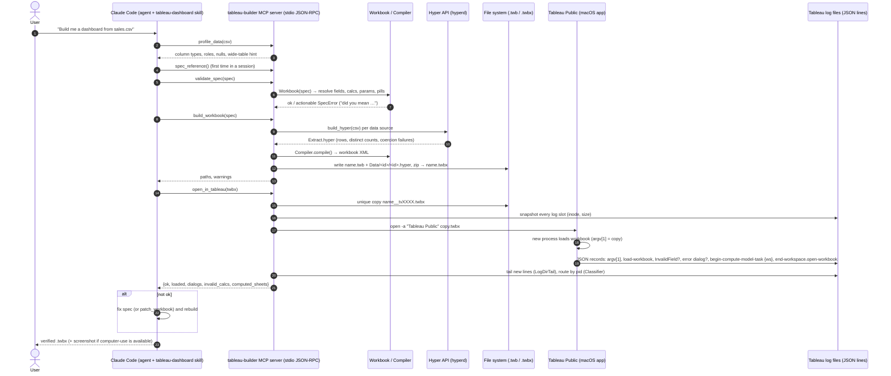

# Architecture

tableau-builder talks to Tableau **through files, not an API**: Tableau Desktop/Public exposes no automation API, AppleScript dictionary or public headers. The server therefore:

1. **Writes** the workbook exactly as Tableau would: `.twb` XML plus Hyper extracts, zipped into a `.twbx`.
2. **Opens** it with macOS `open -a "Tableau Public"`, which starts one Tableau process per workbook.
3. **Reads Tableau's own JSON-lines log** (`~/Documents/My Tableau Repository/Logs/log_N.txt`) to learn whether the load succeeded. That log records schema rejections (as an error dialog), invalid calculations (`InvalidField`) and which sheets computed.

## Class diagram

```mermaid
classDiagram
    direction LR

    class FastMCP_server["server.py (FastMCP)"] {
        +spec_reference() str
        +profile_data(path) dict
        +validate_spec(spec) dict
        +build_workbook(spec) dict
        +open_in_tableau(path, keep_open) dict
        +inspect_workbook(path) dict
        +patch_workbook(path, ops, output) dict
        +diff_workbooks(a, b) dict
    }

    class tools["tabmcp.tools"] {
        +profile_data()
        +validate_spec()
        +build_workbook()
        +open_in_tableau()
        +inspect_workbook()
        +patch_workbook()
        +diff_workbooks()
        +app_build() str
    }

    class Workbook["model.Workbook"] {
        +name: str
        +datasources: dict~str, DataSource~
        +params: dict~str, Param~
        +rewrite_formula(formula, ds) (str, deps, params)
        +calc_closure(field) (fields, params)
        +pill(text, ds) Pill
        +ds_for(sheet) DataSource
        +param(name) Param
    }

    class DataSource["model.DataSource"] {
        +id: str
        +name: federated.*
        +conn: textscan.*
        +csv: Path
        +columns: list~Column~
        +fields: caption → Field
        +by_internal: internal → Field
        +field(caption) Field
    }

    class Field["model.Field"] {
        +caption: str
        +internal: str
        +datatype / role / type
        +formula: str  (rewritten)
        +is_agg / is_table_calc: bool
        +deps / params: set
        +format / geo / colors / aliases
    }

    class Param["model.Param"] {
        +caption: str
        +internal: "Parameter N"
        +datatype / value
        +domain: range | list | any
        +qualified: [Parameters].[...]
    }

    class Pill["model.Pill"] {
        +text: "SUM(Sales):d"
        +agg / derivation / prefix
        +discrete: bool
        +itype: nominal|ordinal|quantitative
        +name: [sum:Sales:qk]
        +qualified: [federated.x].[sum:Sales:qk]
        +is_measure: bool
    }

    class Column["data.Column"] {
        +name / ordinal
        +datatype (inferred over all rows)
        +nulls / distinct / min / max / mean / top
        +role / type / geo / default_agg
    }

    class Compiler["compile.Compiler"] {
        +compile() bytes
        -_datasource()
        -_params_ds()
        -_resolve_sheet() / _resolve_filter()
        -_worksheet() / _deps() / _shelf() / _filter_xml() / _table_style()
        -_dashboard() / _place()   layout tree → zones
        -_actions()
        -_windows()
    }

    class data_io["tabmcp.data"] {
        +profile_csv(path) (columns, rows)
        +build_hyper(csv, columns, out) dict
        +package_twbx(path, twb, bytes, payloads)
        +read_twb_bytes() / write_twb_bytes()
        +stable_id() / calc_id() / bracket()
    }

    class validate_mod["tabmcp.validate"] {
        +validate(path) Report
        +replay(log) Report
        +launch(path)
        +quit_pid(pid)
    }

    class LogDirTail["validate.LogDirTail"] {
        +poll() (file, record)*
        -snapshot inode→size
        -handles truncation & rotation
    }

    class Classifier["validate.Classifier"] {
        +feed(record)
        argv1 · end-workspace.open-workbook
        InvalidField · error dialogs
        begin-compute-model-task (sheets)
    }

    class Report["validate.Report"] {
        +loaded: bool
        +load_failed: str
        +dialogs / invalid_calcs / load_errors
        +expected_sheets / computed_sheets
        +timings
    }

    FastMCP_server --> tools : calls
    tools --> Workbook : builds from spec
    tools --> Compiler : compile()
    tools --> data_io : Hyper + twbx I/O
    tools --> validate_mod : open_in_tableau
    Workbook "1" *-- "many" DataSource
    Workbook "1" *-- "many" Param
    DataSource "1" *-- "many" Field
    DataSource "1" *-- "many" Column
    Field --> Column : physical fields wrap
    Workbook ..> Pill : resolves
    Pill --> Field
    Compiler --> Workbook : reads
    Compiler ..> Pill : emits column-instances
    validate_mod --> LogDirTail
    validate_mod --> Classifier
    Classifier --> Report : fills
```

## How a request flows (Claude ⇄ MCP ⇄ Tableau)

## Why each piece exists
| Piece | Reason |
|---|---|
| `model.Workbook.rewrite_formula` | Tableau formulas must reference **internal** names (`[Calculation_123]`, `[Parameters].[Parameter 1]`). Referencing captions produces silent "red pill" invalid fields. |
| `model.Pill` | One place to turn `SUM(Sales):d` into Tableau's column-instance grammar (`[sum:Sales:ok]`, derivation, type), including `usr:` for aggregating calcs. |
| `compile.Compiler` | Emits the *legacy* content model, which is load-tested in Tableau Public 2026.2: `<sort class=…>`, `sizing-mode`, `dim-percentage`, datasource-level palettes, per-sheet dashboard viewpoints, pinned flow-container sizes. |
| `data.build_hyper` | Tableau Public refuses to save or publish a workbook that isn't extract-backed, so every CSV ships as `[Extract].[Extract]` inside the `.twbx`. |
| `validate.*` | The only reliable headless signal. Data errors never raise a dialog. Each opened file runs in its own Tableau process with its own log slot, which can be truncated and reused, so the tail must route by pid. |
| `patch_workbook` / `diff_workbooks` | Escape hatch: learn any feature by changing it in Tableau's UI and diffing, then patch it in. |
